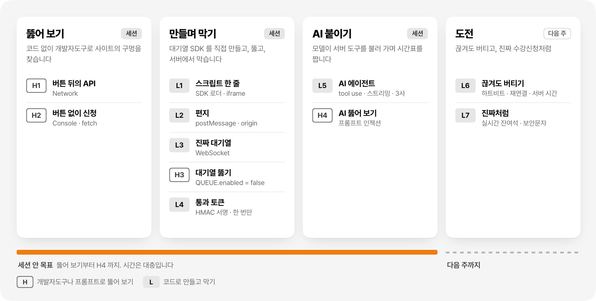

<picture>
  <source media="(prefers-color-scheme: dark)" srcset="docs/images/hero-dark.png">
  
</picture>

<p align="center">
  <a href="#빠른-시작">빠른&nbsp;시작</a> ·
  <a href="#구조">구조</a> ·
  <a href="#실습-단계">실습&nbsp;단계</a> ·
  <a href="docs/MISSIONS.md">미션</a> ·
  <a href="docs/PROTOCOL.md">메시지&nbsp;규칙</a> ·
  <a href="#ai-설정">AI&nbsp;설정</a> ·
  <a href="#코딩-에이전트와-같이-하기">코딩&nbsp;에이전트</a>
</p>

## 이 실습에서 하는 일

수강신청 날 보던 "서비스 접속 대기 중입니다. 내 앞에 2,431명" 화면을 직접 만듭니다.

이 저장소에는 회사가 둘 있습니다. 수강신청 사이트를 운영하는 **학교(고객사)** 와, 그 사이트에 대기열을 붙여 주는 **우리(NEXT Queue)** 입니다. 여러분은 우리 회사 개발자가 되어, 남의 사이트에 스크립트 한 줄로 심기는 대기열 SDK 를 완성합니다.

먼저 개발자도구로 사이트를 뚫어 보고, 직접 만들면서 하나씩 막고, AI 에이전트를 붙인 뒤 그 AI 도 뚫어 봅니다. 끝나면 이 문장을 자기 말로 설명할 수 있어야 합니다.

> 브라우저도, AI 모델도 믿지 않습니다. 지키는 것은 서버입니다.

## 빠른 시작

Node 20 이상이 필요합니다.

```bash
git clone https://github.com/danlee-dev/next-sugang-lab.git
cd next-sugang-lab
npm install
npm run dev
```

- **수강신청** http://localhost:3000 : 오른쪽 위에서 샘플 학생을 고르고 Login 을 누릅니다
- **운영 콘솔** http://localhost:4000/console/ : **지금 시작** 으로 수강신청을 열고, 가상 대기자를 넣습니다

창 두 개를 나란히 두고 [docs/MISSIONS.md](docs/MISSIONS.md) 의 H1 부터 시작합니다. `.env` 는 없어도 됩니다. 서버 코드를 고치면 서버가 알아서 다시 켜지고, 브라우저는 새로고침하면 됩니다.

## 구조

<picture>
  <source media="(prefers-color-scheme: dark)" srcset="docs/images/architecture-dark.png">
  
</picture>

포트가 다르면 origin 이 다릅니다. 3000 과 4000 은 브라우저 입장에서 서로 남이라, 실제 서비스와 같은 cross-origin 상황이 노트북 한 대에서 그대로 생깁니다.

1. **SDK 파일**: 학교 페이지 head 의 `<script>` 한 줄이 :4000 에서 로더(`sdk/queue.js`)를 받아 옵니다. 남의 페이지 안에서 우리 코드가 실행됩니다.
2. **postMessage**: 로더가 대기 화면을 iframe 으로 띄웁니다. 두 화면은 서로의 DOM 에 손댈 수 없어서 편지(`ready`, `start`, `pass`)로만 이야기합니다.
3. **줄 서기**: 대기 화면이 `/ws` WebSocket 으로 줄을 서고, 순번을 실시간으로 받다가, 차례가 되면 서명된 통과 토큰을 받습니다.
4. **신청과 토큰**: 학교 페이지가 토큰을 붙여 `POST /api/enroll` 을 보냅니다.
5. **같은 비밀키**: 학교 서버는 대기열 서버와 나눠 가진 `QUEUE_SECRET` 으로 토큰의 서명, 만료, 학번을 확인하고, 한 번만 받아 줍니다.
6. **실시간 중계**: `/live` WebSocket 으로 서버 시간, 잔여석, AI 가 일하는 과정이 흘러옵니다.
7. **AI**: 학교 서버 안의 에이전트가 Claude, OpenAI, Gemini 중 하나와 대화하면서, 학교가 빌려준 도구로만 데이터를 봅니다.

### 신청 한 번이 지나가는 길

<picture>
  <source media="(prefers-color-scheme: dark)" srcset="docs/images/flow-dark.png">
  
</picture>

화살표 옆의 L1~L4 는 그 화살표를 어느 레벨에서 만드는지 가리킵니다. 메시지 형식은 [docs/PROTOCOL.md](docs/PROTOCOL.md) 에 있습니다.

## 실습 단계

<picture>
  <source media="(prefers-color-scheme: dark)" srcset="docs/images/stages-dark.png">
  
</picture>

세션 안에서는 뚫어 보기부터 H4 까지를 목표로 합니다. 시간은 대충이라, 못 끝낸 것과 도전은 다음 주까지 해 오면 됩니다. 레벨마다 할 일과 확인 항목은 [docs/MISSIONS.md](docs/MISSIONS.md) 에 있습니다.

<details>
<summary>레벨 목록을 글로 보기</summary>

| 단계 | 레벨 | 무엇을 | 배우는 것 |
|------|------|--------|----------|
| 뚫어&nbsp;보기 | H1, H2 | Network 로 버튼 뒤의 API 를 찾고, Console 에서 버튼 없이 신청하기 | 버튼 뒤의 API, 화면을 거치지 않는 요청 |
| 만들며&nbsp;막기 | L1 | 스크립트 한 줄로 대기 화면 띄우기 | 스니펫과 비동기 로더, iframe, sandbox |
| | L2 | 학교 페이지와 대기 화면이 편지 주고받기 | postMessage, targetOrigin, origin 확인 |
| | L3 | 진짜 대기열 | WebSocket, 서버가 밀어 주는 순번 |
| | H3 | `QUEUE.enabled = false` 로 줄 건너뛰기 | 브라우저 스위치로는 아무것도 못 지킨다는 것 |
| | L4 | 통과 토큰 | HMAC 서명, 만료, 한 번만 쓰기 |
| AI&nbsp;붙이기 | L5 | AI 시간표 에이전트 | tool use 루프, 스트리밍, 회사별 메시지 모양 |
| | H4 | 프롬프트로 AI 꼬드기기 | 프롬프트 인젝션, 모델이 아니라 도구가 지킨다는 것 |
| 도전 | L6 | 끊겨도 버티기 | 하트비트, 재연결, 서버 시간 맞추기 |
| | L7 | 진짜처럼 | 실시간 잔여석 방송, 보안문자 |

</details>

## 화면

<table>
  <tr>
    <td width="50%" valign="top">
      
      <br><sub><b>AI 시간표 도우미 (L5)</b>. 도구 호출이 칩으로 하나씩 나타나고, 마지막에 제안 표가 뜹니다</sub>
    </td>
    <td width="50%" valign="top">
      <picture>
        <source media="(prefers-color-scheme: dark)" srcset="docs/images/screen-console-dark.png">
        
      </picture>
      <br><sub><b>운영 콘솔</b>. 입장 속도와 수강신청 시작 시각을 바꾸고, 가상 학생 수백 명을 몰려오게 합니다</sub>
    </td>
  </tr>
</table>

## AI 설정

L5 와 H4 에는 AI 키가 하나 필요합니다. 세션 전에 셋 중 **아무 회사 하나**의 키를 받아 옵니다. 어느 회사 키든 같은 코드로 돕니다.

```bash
cp .env.example .env    # 그다음 .env 에 키 하나를 넣습니다
```

| 회사 | 키 받는 곳 | `.env` | 기본 모델 |
|------|-----------|--------|----------|
| Claude | https://console.anthropic.com | `ANTHROPIC_API_KEY` | claude-opus-5-5 |
| OpenAI | https://platform.openai.com | `OPENAI_API_KEY` | gpt-6-luna |
| Gemini | https://aistudio.google.com (무료 사용량이 있습니다) | `GEMINI_API_KEY` | gemini-3.6-flash |

- 회사는 `AI_PROVIDER` 로 고릅니다. 비워 두면 키가 들어 있는 첫 회사를 씁니다. 모델은 `AI_MODEL` 로 바꿉니다.
- 서버를 켜면 터미널에 `> AI 시간표  Claude claude-opus-5-5` 처럼 지금 쓰는 모델이 찍힙니다.
- 키가 없으면 모의 AI 가 같은 흐름을 보여 줍니다. L5 는 모의 AI 로도 할 수 있지만, H4 는 진짜 모델이어야 의미가 있습니다.
- 키는 서버의 `.env` 에만 둡니다. 브라우저로 내려가는 파일에 쓰거나 커밋하지 않습니다.

## 코딩 에이전트와 같이 하기

Codex 와 Claude Code 는 저장소 루트의 [AGENTS.md](AGENTS.md) 를 읽고 시작합니다. Claude Code 는 [CLAUDE.md](CLAUDE.md) 를 거쳐 같은 파일을 읽습니다. 거기에 "한 번에 레벨 하나, 계획을 먼저, H 레벨은 학생이 직접" 같은 규칙이 있어서, 에이전트가 정답을 한꺼번에 다 써 버리지 않고 사수처럼 같이 갑니다.

이렇게 부탁하면 됩니다.

| 언제 | 이렇게 말합니다 |
|------|----------------|
| 처음 | AGENTS.md 와 docs/MISSIONS.md 를 읽고 이 저장소 구조를 5줄로 설명해 줘. 코드는 아직 고치지 마 |
| 레벨 시작 | L3 하자. 먼저 계획을 말해 주고, 내가 좋다고 하면 고쳐 줘 |
| 막혔을 때 | L3 했는데 내 앞 인원이 안 줄어. 고치지 말고 서버 로그와 Network 에서 뭘 봐야 하는지만 알려 줘 |
| 직접 짰을 때 | L4 를 내가 직접 짰어. 보안상 빠진 게 있는지 리뷰만 해 줘 |
| H 레벨 | H2 하려는데 힌트만 줘. 답은 말하지 마 |
| 끝나고 | 방금 L4 에서 바꾼 것을 내가 설명해 볼게. 틀린 데를 짚어 줘 |

에이전트가 레벨을 끝내면 바꾼 파일, 이유, 확인할 것을 남깁니다. 확인은 꼭 직접 합니다.

## 끝나고 설명할 수 있어야 하는 것

1. 신청 버튼을 누른 뒤 토큰 하나가 대기열 서버에서 학교 서버까지 가는 길
2. postMessage 에서 origin 을 확인하는 이유와, 그것만으로는 못 막는 것
3. 브라우저에 있는 스위치(`QUEUE.enabled`)로는 아무것도 지킬 수 없는 이유
4. 프롬프트로 AI 를 꼬드겨도 남의 신청 내역이 나오지 않는 이유

## 폴더

| 경로 | 누구 | 하는 일 |
|------|------------|--------|
| `site/` | 학교 | 수강신청 화면. head 에 대기열 스니펫 한 줄이 붙어 있습니다 |
| `server/school.js` | 학교 | 수강신청 API, 세션, 정원, `/live` WebSocket, AI 에게 빌려주는 도구 |
| `server/ai.js` | 학교 | AI 시간표 에이전트 루프 |
| `server/providers.js` | 학교 | Claude, OpenAI, Gemini 연결부. 회사마다 다른 메시지 모양을 맞춥니다 |
| `sdk/queue.js` | 우리 | 학교 페이지에서 실행되는 로더. iframe 을 띄우고 편지를 중계합니다 |
| `widget/` | 우리 | iframe 안의 대기 화면. 대기열 서버와 WebSocket 으로 이야기합니다 |
| `console/` | 우리 | 대기열 운영 콘솔 |
| `server/queue.js`, `server/token.js` | 우리 | 줄 세우기, 입장, 통과 토큰 서명 |
| `server/index.js`, `server/sim.js` | 실습 틀 | 두 서버, Origin 검사, CSP, 몰려오는 가상 학생 |
| `shared/tokens.css`, `DESIGN.md` | 우리 | 우리 화면의 디자인 토큰과 규칙 |
| `docs/` | 문서 | [MISSIONS](docs/MISSIONS.md) (할 일), [PROTOCOL](docs/PROTOCOL.md) (메시지 형식), 그림 |
| `AGENTS.md`, `CLAUDE.md` | 문서 | 코딩 에이전트 규칙 |

## 주의

- 이 사이트는 실습용 클론입니다. 실제 고려대학교 수강신청과 무관하고, 학교 로고나 자산은 쓰지 않았습니다.
- H1~H4 는 **이 저장소의 로컬 서버에서만** 합니다. 실제 학교 사이트를 상대로 매크로를 만들거나 돌리지 않습니다.
- 비밀값(`QUEUE_SECRET`, AI 키)은 `.env` 에만 둡니다. `site/`, `sdk/`, `widget/`, `console/` 은 브라우저로 내려가는 파일이라 비밀값을 쓰면 안 됩니다.
